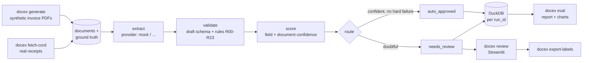
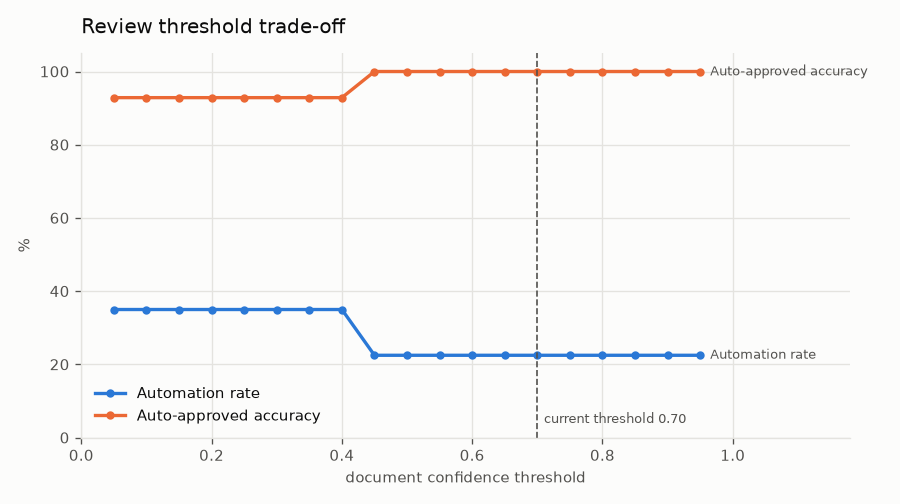
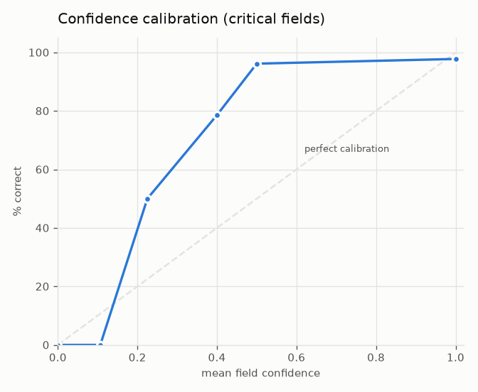

# llm-doc-extractor

[](https://github.com/ExHansen/llm-doc-exctractor/actions/workflows/ci.yml)

**A quality-control pipeline for document extraction:** it turns Indonesian invoices and receipts
into structured data, checks every field against business rules, scores its own confidence,
sends doubtful documents to a human review queue, and measures how well all of that works.

> Phase 1 runs **fully offline**. Extraction uses a *mock provider* that returns the ground truth
> with realistic LLM/OCR mistakes, so the QC layer can be built and measured before any model is
> plugged in. Real providers (a local model via Ollama, or a cloud LLM) slot in behind one
> interface. See [Adding a provider](#adding-a-provider).

## Why

Getting an LLM to read an invoice is the easy part. The hard part is knowing **which outputs you
can trust** without a person checking every document. That is a data-quality problem:

- validate values against rules a finance team actually uses (subtotal + PPN = total, NPWP format),
- turn rule results and model self-consistency into a calibrated confidence score,
- route only the doubtful documents to people, and
- prove with numbers that the auto-approved documents are right.

I built this as a bridge from data quality control into data/AI engineering. The extractor is
replaceable; the QC around it is the product.

## What it does

| Stage | What happens |
|---|---|
| `generate` | Renders synthetic Indonesian invoice PDFs (3 templates, Indonesian number and date formats, PPN 11% and *DPP Nilai Lain* 11/12 x 12%), some with injected faults and some degraded to look scanned. Ground truth is written alongside. |
| `fetch-cord` | Optionally adds real Indonesian receipts from the CORD v2 dataset. |
| `run` | Extracts each document (twice, for self-consistency), validates it against rules R00-R23, scores confidence per field and per document, and routes it to `auto_approved` or `needs_review`. Everything is stored in DuckDB under a `run_id`. |
| `review` | A Streamlit queue: the document image next to editable fields, flagged fields first, approve or correct. |
| `export-labels` | Turns reviewer corrections into new ground-truth labels. |
| `eval` | Scores a run against ground truth: field accuracy, line-item F1, automation rate, accuracy of what was auto-approved, error and fault catch rates, a threshold trade-off curve and a calibration chart. |
| `demo` | `generate` + `run` + `eval` in one command. |

## Architecture



## Quickstart

Requires Python 3.11+ and [uv](https://docs.astral.sh/uv/).

```bash
uv sync
uv run docex demo          # 40 invoices -> run -> report, in about 20 seconds
uv run docex review        # open the review queue in your browser
```

Optional, needs internet (downloads the 234 MB CORD v2 test split into the Hugging Face cache):

```bash
uv run docex fetch-cord --n 50
uv run docex run --source cord
uv run docex eval
```

Every setting can be changed through `DOCEX_*` environment variables or a `.env` file; see
[`.env.example`](.env.example).

## Results

> **Simulated extractor.** These numbers come from the mock provider, seed 42. They measure the
> QC pipeline (validation, confidence, routing), not a model.

| Dataset | Docs | Automation rate | Auto-approved accuracy | Error catch rate | Fault catch rate | Document accuracy | Line-item F1 |
|---|---|---|---|---|---|---|---|
| Synthetic invoices (`docex demo`) | 40 | 22.5% | **100%** | **100%** | **100%** | 65.0% | 85.6% |
| CORD receipts (`--source cord`) | 50 | 72.0% | **100%** | **100%** | n/a | 92.0% | 88.9% |

What these say:

- **Nothing wrong was auto-approved.** Every document with a wrong critical field, and every
  invoice with a printed fault (wrong total, invalid NPWP, due date before issue date, wrong line
  amount), went to the review queue.
- **The router is conservative.** On invoices it also sends correct documents to review, mostly
  because a line item failed a rule or the two extraction attempts disagreed. The trade-off curve
  shows the price of automating more: at threshold 0.30 automation rises to 35.0% and
  auto-approved accuracy falls to 92.9%.
- **Confidence is under-confident, which is safe:** fields scored around 0.5 were right 96% of
  the time. That is the first thing to tune once a real model is plugged in.

Full report: [`docs/example-report/report.md`](docs/example-report/report.md).




## Design decisions

- **Draft vs. strict schemas.** Extractor output is parsed into a *draft* model where every field
  is optional, so one unreadable date does not throw away the other fields. Ground truth and
  reviewer corrections must satisfy the *strict* model.
- **Hard vs. soft rules.** A hard failure (totals don't add up, invalid seller NPWP, due date
  before issue date) always sends a document to review. A soft failure (an unusual tax rate, a
  receipt whose printed numbers don't reconcile) only lowers confidence. Rules for CORD receipts
  are soft because real receipts are often inconsistent.
- **Confidence.** Each field starts at 1.0 and is multiplied down: missing required -> 0, invalid
  format x0.3, hard rule x0.5, soft rule x0.8, the two attempts disagree x0.4. Document confidence
  is the minimum over critical fields.
- **Self-consistency.** Each document is extracted twice; disagreement is a cheap uncertainty
  signal that does not need a second model.
- **Ground truth = what is printed.** If an invoice prints a wrong total, the label is that wrong
  total. Extraction is judged on reading the document; validation is judged on catching the error.
- **Routing never reads ground truth.** Only the evaluator does.
- **Idempotent, append-only runs.** Every run gets its own `run_id`, so runs can be compared.

## Validation rules

| ID | Applies to | Rule | Severity |
|---|---|---|---|
| R00_parse | all | a value is present but cannot be parsed (e.g. `31/02/2026`) | hard |
| R01 | all | required field missing | hard |
| R02 | invoice | quantity x unit price = line amount | hard |
| R03 | invoice | subtotal = sum of line amounts | hard |
| R04 | invoice | tax base = subtotal - discount, or 11/12 of it (*DPP Nilai Lain*) | soft |
| R05 | invoice | tax amount = tax base x tax rate | hard |
| R06 | invoice | total = subtotal - discount + tax | hard |
| R07 / R07B | invoice | seller / buyer NPWP has 15 or 16 digits | hard / soft |
| R08 | invoice | invoice year between 2015 and next year | soft |
| R09 | invoice | due date not before invoice date | hard |
| R10 | invoice | tax rate is 11% or 12% | soft |
| R11 | all | amounts are not negative | hard |
| R20 | receipt | total present | hard |
| R21 | receipt | subtotal = sum of item prices | soft |
| R22 | receipt | total = subtotal - discount + service + tax | soft |
| R23 | receipt | change = cash - total | soft |

Amounts allow 1 rupiah of rounding per term.

## Adding a provider

A provider is any class with `name`, `model` and an `extract` method that returns JSON-native
field values. Register it in `src/docex/providers/registry.py` and select it with
`--provider` or `DOCEX_PROVIDER`.

```python
# src/docex/providers/my_llm.py
from docex.results import ExtractionResult


class MyLLMProvider:
    name = "my_llm"
    model = "my-model-v1"

    def extract(self, doc, schema, attempt):
        # 1. read the file at settings.data_dir / doc.path
        # 2. ask the model for JSON that matches schema.model_json_schema()
        # 3. return the raw values; validation and scoring happen downstream
        data = ...
        return ExtractionResult(
            "ok",
            data,
            None,
            latency_ms=0.0,
            input_tokens=None,
            output_tokens=None,
            cost_usd=None,
            simulated=False,
        )


# src/docex/providers/registry.py
PROVIDERS["my_llm"] = lambda settings: MyLLMProvider()
```

Return `status="failed"` instead of raising for problems with one document; the pipeline also
catches exceptions, so one bad file never stops a run.

## Data

- **Synthetic invoices.** Fake companies and addresses from Faker `id_ID`, a catalog of office
  supplies, logistics, groceries and IT services, invoice numbers like `INV/2026/11/00123`,
  amounts printed as `Rp 1.234.567`, `1.234.567,00` or `IDR 1,234,567`, and dates such as
  `05 November 2026` or `05/11/2026`. NPWP values are random and only format-valid.
- **CORD v2** receipts: Park et al., *CORD: A Consolidated Receipt Dataset for Post-OCR
  Parsing* (2019), [`naver-clova-ix/cord-v2`](https://huggingface.co/datasets/naver-clova-ix/cord-v2),
  licensed CC-BY-4.0. Labels are mapped to the receipt schema; values that cannot be parsed are
  recorded as `gt_issues` and left out of scoring.

## Limitations

- Phase 1 numbers come from a simulated extractor. They show that the QC layer catches errors of
  the kinds and rates the mock injects, not how a particular model behaves.
- Invoices are single-page and synthetic; no real e-Faktur or tax-office QR validation.
- The review UI is single-user and has no authentication.

## Roadmap

1. **Local LLM, still offline:** an `ollama` provider (OCR with RapidOCR, then a small text model
   with schema-constrained JSON output), compared against the mock and a rule-based baseline.
2. Optional cloud provider, side-by-side accuracy, cost and latency per model, and a FastAPI
   endpoint.

## Development

```bash
uv run pytest            # 186 tests, no network needed
uv run ruff check
uv run ruff format --check
```

Design notes: [`docs/superpowers/specs/`](docs/superpowers/specs/) ·
implementation plan: [`docs/superpowers/plans/`](docs/superpowers/plans/).

## License

MIT, see [LICENSE](LICENSE).
