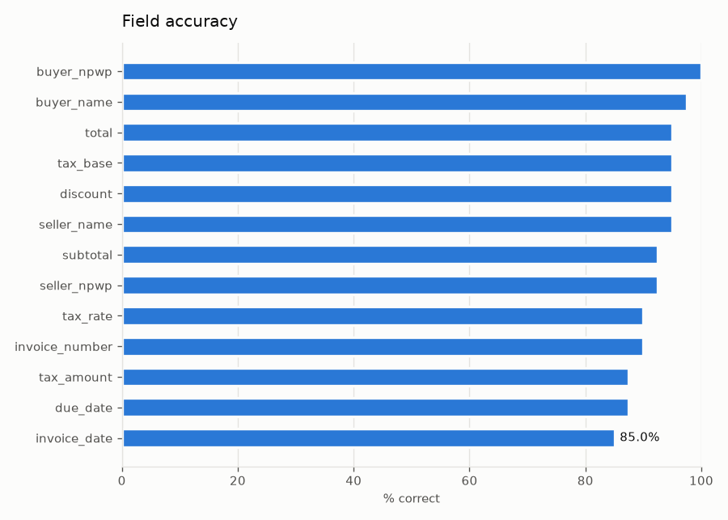
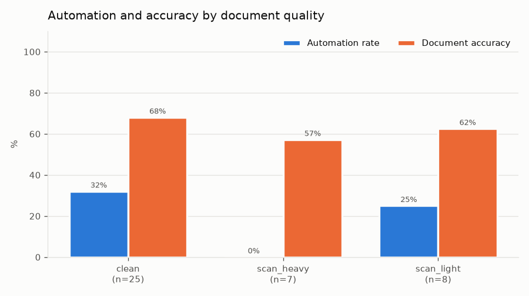
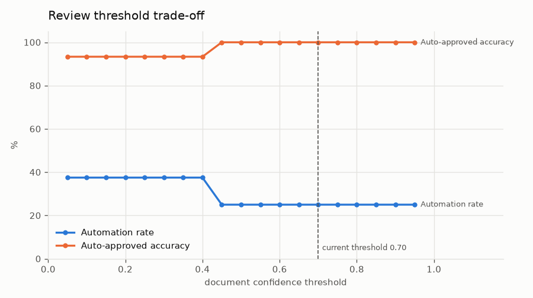
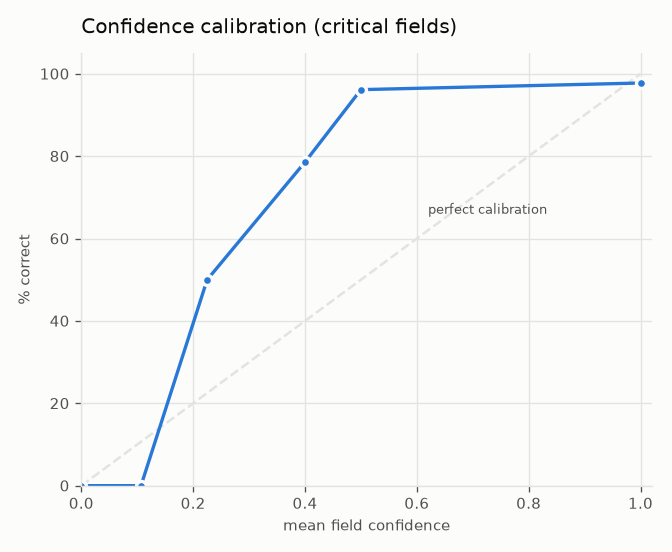

# Extraction QC report: run `20261105-201655-mock`

> **Simulated extractor.** These numbers come from the offline mock provider, which returns ground truth with injected LLM/OCR-style errors. They measure the QC pipeline (validation, confidence, routing), not a real model.

## Headline

| Metric | Value | Meaning |
|---|---|---|
| Documents | 40 | Documents in the run. |
| Automation rate | 25.0% | Share of documents auto-approved. |
| Auto-approved accuracy | 100.0% | Share of auto-approved documents whose critical fields are all correct. |
| Error catch rate | 100.0% | Share of documents with a wrong critical field that were sent to review. |
| Fault catch rate | 100.0% | Share of documents with a printed fault (wrong total, bad NPWP...) sent to review. |
| Document accuracy | 65.0% | Share of documents with every critical field correct. |
| Line-item F1 | 87.4% | Line items extracted with every field correct. |

Review threshold: **0.70** (document confidence).

## Field accuracy

| Field | Accuracy |
|---|---|
| `buyer_name` | 97.5% |
| `buyer_npwp` | 100.0% |
| `discount` | 95.0% |
| `due_date` | 87.5% |
| `invoice_date` | 85.0% |
| `invoice_number` | 90.0% |
| `seller_name` | 95.0% |
| `seller_npwp` | 92.5% |
| `subtotal` | 92.5% |
| `tax_amount` | 87.5% |
| `tax_base` | 95.0% |
| `tax_rate` | 90.0% |
| `total` | 95.0% |

## Fault catch rate by fault type

| Injected fault | Sent to review |
|---|---|
| `due_before_issue` | 100.0% |
| `invalid_npwp` | 100.0% |
| `line_amount_mismatch` | 100.0% |
| `total_mismatch` | 100.0% |

## Breakdown

### By quality

| quality | n | Automation rate | Document accuracy |
|---|---|---|---|
| clean | 25 | 32.0% | 68.0% |
| scan_heavy | 7 | 0.0% | 57.1% |
| scan_light | 8 | 25.0% | 62.5% |

### By source

| source | n | Automation rate | Document accuracy |
|---|---|---|---|
| synthetic | 40 | 25.0% | 65.0% |

### By template

| template | n | Automation rate | Document accuracy |
|---|---|---|---|
| klasik | 17 | 29.4% | 64.7% |
| minimal | 10 | 30.0% | 60.0% |
| modern | 13 | 15.4% | 69.2% |

## Threshold trade-off

Raising the threshold sends more documents to review and makes the auto-approved set more accurate.

| Threshold | Automation rate | Auto-approved accuracy |
|---|---|---|
| 0.05 | 37.5% | 93.3% |
| 0.10 | 37.5% | 93.3% |
| 0.15 | 37.5% | 93.3% |
| 0.20 | 37.5% | 93.3% |
| 0.25 | 37.5% | 93.3% |
| 0.30 | 37.5% | 93.3% |
| 0.35 | 37.5% | 93.3% |
| 0.40 | 37.5% | 93.3% |
| 0.45 | 25.0% | 100.0% |
| 0.50 | 25.0% | 100.0% |
| 0.55 | 25.0% | 100.0% |
| 0.60 | 25.0% | 100.0% |
| 0.65 | 25.0% | 100.0% |
| 0.70 | 25.0% | 100.0% |
| 0.75 | 25.0% | 100.0% |
| 0.80 | 25.0% | 100.0% |
| 0.85 | 25.0% | 100.0% |
| 0.90 | 25.0% | 100.0% |
| 0.95 | 25.0% | 100.0% |

## Calibration

Do fields with confidence X turn out correct X% of the time?

| Confidence bin | Fields | Mean confidence | Accuracy |
|---|---|---|---|
| 0.0-0.1 | 5 | 0.00 | 0.0% |
| 0.1-0.2 | 3 | 0.11 | 0.0% |
| 0.2-0.3 | 2 | 0.23 | 50.0% |
| 0.4-0.5 | 14 | 0.40 | 78.6% |
| 0.5-0.6 | 26 | 0.50 | 96.2% |
| 0.9-1.0 | 223 | 1.00 | 97.8% |
